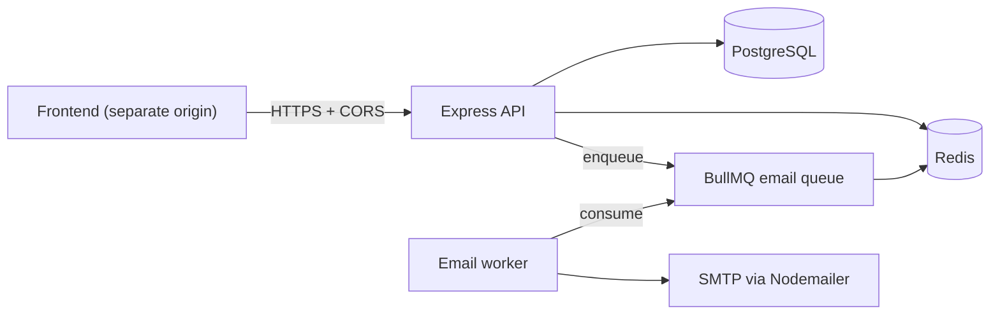
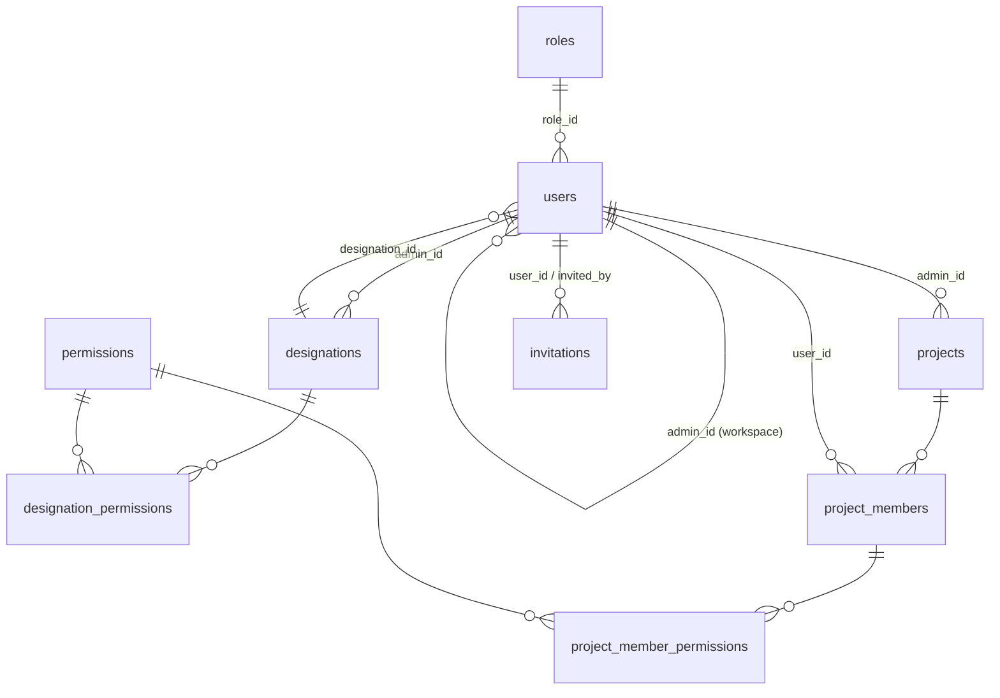

# SQL Workspace – Architecture

> **Status:** Approved baseline v1.0 (2026-11-10). Changes require approval from the project owner (see `RULES.md` §2).

---

## 1. Overview
This is a single-process **modular monolith**: an Express REST API written in TypeScript. PostgreSQL is the system of record. Redis is used for refresh tokens, rate limits, lockout counters and BullMQ queues. A separate **email worker process** consumes jobs from the queue. The API is used by a separate frontend on another origin [D23].



## 2. Technology Stack
Exact versions are pinned in `package.json` during Phase 1. Only stable major versions are used.

| Concern | Choice |
|---|---|
| Runtime | Node.js 20 LTS |
| Language | TypeScript (strict) |
| HTTP | Express 4 |
| Database / ORM | PostgreSQL 16 + Sequelize 6 (`sequelize-cli` for migrations) [D20] |
| Validation | Zod |
| Cache, rate limiting, token store | Redis 7 via `ioredis`, `rate-limiter-flexible` |
| Jobs | BullMQ |
| Email | Nodemailer |
| Auth | `jsonwebtoken`, `bcrypt` |
| Security middleware | `helmet`, `cors`, `cookie-parser` |
| Logging | `pino` (+ `pino-http`) |
| Testing | Jest + ts-jest + Supertest |
| API Documentation | Swagger / OpenAPI 3.0 via `swagger-ui-express` + `swagger-jsdoc` |
| Code quality | ESLint + Prettier |
| Local infrastructure | Docker Compose (Postgres, Redis, Mailpit for viewing test emails) |

## 3. Folder Structure
```
sql_workspace/
  docs/                      # REQUIREMENTS, RULES, ARCHITECTURE, IMPLEMENTATION_PLAN
  PROGRESS.md
  docker-compose.yml
  .env.example
  src/
    config/                  # env.ts (Zod), database.ts, redis.ts, logger.ts, swagger.ts
    common/
      errors/                # AppError + subclasses
      middleware/            # authenticate, authorize, requireProjectPermission,
                             # validate, rateLimit, errorHandler, notFound
      utils/                 # crypto (token hashing), pagination, response helpers
      types/                 # Express request augmentation, shared enums
    models/                  # Centralized Sequelize model definitions and associations
      user.model.ts
      role.model.ts
      permission.model.ts
      designation.model.ts
      designation-permission.model.ts
      project.model.ts
      project-member.model.ts
      project-member-permission.model.ts
      invitation.model.ts
      index.ts               # Model registry & associations setup
    modules/
      auth/                  # login, refresh, logout, change/forgot/reset password
      roles/                 # read-only system roles
      permissions/           # permission catalog
      admins/                # Super Admin management of Admins
      users/                 # Admin management of Users
      designations/
      invitations/           # issue, accept, resend, revoke
      projects/
      project-members/       # membership + permission grants
        <module>.routes.ts  <module>.controller.ts  <module>.service.ts
        <module>.schema.ts  index.ts
    jobs/
      queues.ts              # queue definitions
      email.worker.ts        # worker entrypoint (separate process)
      templates/             # email templates
    database/
      migrations/  seeders/
    app.ts                   # builds the Express app (no listen)
    server.ts                # starts HTTP server
  tests/
    unit/  integration/  helpers/
```

## 4. Data Model

All primary keys are UUIDs. Tables have `created_at` and `updated_at`. Workspace-owned tables use `deleted_at` for soft delete (paranoid) [D14].

**The workspace is the Admin.** Each Admin's user id is used as the workspace id. Workspace-owned rows carry `admin_id`. This keeps D1 simple and avoids a separate organizations table, which can be added later if needed.



| Table | Key columns | Notes |
|---|---|---|
| `roles` | `id`, `name` (`SUPER_ADMIN`/`ADMIN`/`USER`) | Seeded, read-only [D4] |
| `permissions` | `id`, `module` (nullable), `action` (`READ`/`CREATE`/`UPDATE`/`DELETE`/`MANAGE_MEMBERS`) | Seeded catalog. `module = NULL` means project-wide (v1). Unique on (`module`, `action`). Per-module permissions are added later as new rows [D6] |
| `users` | `id`, `email` (citext), `password_hash` (nullable until accepted), `first_name`, `last_name`, `role_id`, `admin_id` (nullable), `designation_id` (nullable), `status` (`INVITED`/`ACTIVE`/`INACTIVE`), `must_change_password`, `password_changed_at`, `deleted_at` | `email` globally unique, including soft-deleted rows [D12]. `admin_id`: NULL for Super Admin and Admins, set for Users. Check constraint: Users must have `admin_id` and `designation_id` [D17] |
| `designations` | `id`, `admin_id`, `name`, `description`, `deleted_at` | Partial unique index (`admin_id`, lower(`name`)) WHERE `deleted_at IS NULL` |
| `designation_permissions` | `designation_id`, `permission_id` | Default templates [D5] |
| `projects` | `id`, `admin_id`, `name`, `description`, `status` (`ACTIVE`/`ARCHIVED`), `start_date`, `end_date`, `deleted_at` | Partial unique index (`admin_id`, lower(`name`)) |
| `project_members` | `id`, `project_id`, `user_id`, `added_by`, `deleted_at` | Partial unique index (`project_id`, `user_id`) |
| `project_member_permissions` | `project_member_id`, `permission_id` | The actual grants. Defaults are **copied** from the designation when a member is added [D5, BR-18] |
| `invitations` | `id`, `user_id`, `invited_by`, `token_hash`, `status` (`PENDING`/`ACCEPTED`/`EXPIRED`/`REVOKED`), `expires_at`, `accepted_at`, `revoked_at` | Partial unique index on `user_id` WHERE `status='PENDING'` (BR-42) |

*Password reset tokens are kept in Redis only (key `pwreset:{userHash}`, 1-hour TTL), so no table is needed.*

## 5. Authentication and Authorization

### 5.1 Tokens [D18]
- **Access token:** a JWT (HS256) that lasts 15 minutes. Claims: `sub`, `role`, `adminId`, `jti`. Sent as `Authorization: Bearer <token>`.
- **Refresh token:** an opaque random value (32 bytes) that lasts 7 days. Stored in Redis as `refresh:{sha256(token)} → { userId, familyId }` with a 7-day TTL, plus a set `user_sessions:{userId}` so all of a user's sessions can be revoked (BR-9, BR-49).
- **Delivery:** the refresh token is set as a `refresh_token` cookie with `httpOnly`, `Secure`, `SameSite=None`, scoped to `/api/v1/auth`. CORS uses `credentials: true` with an explicit origin allow-list.
- **Rotation:** each `/auth/refresh` call deletes the old token and issues a new one. If an already-used refresh token is presented, every session in that token family is revoked, because it means the token was stolen.
- **Logout** deletes the current refresh token.
- **Access check on each request:** `authenticate` verifies the JWT and then loads the user's status and their Admin's status from a short Redis cache (60 seconds), invalidated whenever a status changes. This lets deactivation (BR-9) take effect quickly despite stateless JWTs.

### 5.2 Lockout and Rate Limiting [D19]
- **Lockout:** failed logins are counted in Redis per email (`login_fail:{email}`). Five failures lock the account for 15 minutes. A successful login resets the counter.
- **Rate limits** (`rate-limiter-flexible`, Redis):

  | Endpoint | Limit |
  |---|---|
  | Login | 10/min per IP |
  | Forgot password | 5 per hour per IP + email |
  | Accept invitation / reset | 10/min per IP |
  | Invite and resend | 30 per hour per user |
  | Everything else | 300/min per user |

### 5.3 Authorization Layers
1. `authenticate`: requires a valid access token and an active account and workspace.
2. `authorize(...roles)`: role guard, e.g. `authorize('SUPER_ADMIN')`.
3. **Tenant scoping in services:** `adminId` always comes from `req.user`. Super Admin endpoints take an explicit `adminId` path parameter.
4. `requireProjectPermission(action)`:
   - Super Admin and the owning Admin always pass.
   - Otherwise, it loads the member's grants for `:projectId` and checks the action.
   - Grants are cached in Redis as `perm:{projectId}:{userId}` and invalidated whenever membership or grants change.
5. Escalation checks for `MANAGE_MEMBERS` (BR-29) live in `ProjectMemberService`.

## 6. API Conventions
- Base path `/api/v1`. JSON only. Resource names are plural and kebab-case.
- **Success response:** `{ "success": true, "data": <payload>, "meta"?: { "page", "limit", "total" } }`
- **Error response:** `{ "success": false, "error": { "code": "VALIDATION_ERROR", "message": "...", "details"?: [...] } }`
- **Pagination:** `?page=1&limit=20` (maximum `limit` is 100). **Sorting:** `?sort=created_at:desc`.
- **Status codes:** 200, 201, 204, 400 (validation), 401, 403, 404, 409 (conflict, e.g. duplicate email), 422 (business rule violated), 429, 500.

### 6.1 Planned Endpoints (v1)
| Area | Endpoints |
|---|---|
| Auth (public) | `POST /auth/login`, `POST /auth/refresh`, `POST /auth/logout`, `POST /auth/forgot-password`, `POST /auth/reset-password`, `GET /invitations/:token/verify`, `POST /invitations/accept` |
| Auth (logged in) | `GET /auth/me`, `POST /auth/change-password` |
| Super Admin | `GET/POST /admins`, `GET/PATCH/DELETE /admins/:id`, `POST /admins/:id/activate`, `POST /admins/:id/deactivate` |
| Users | `GET/POST /users`, `GET/PATCH/DELETE /users/:id`, `POST /users/:id/activate`, `POST /users/:id/deactivate` |
| Invitations | `POST /invitations/:id/resend`, `POST /invitations/:id/revoke`, `GET /invitations` |
| Designations | `GET/POST /designations`, `GET/PATCH/DELETE /designations/:id`, `PUT /designations/:id/permissions` |
| Projects | `GET/POST /projects`, `GET/PATCH/DELETE /projects/:id` |
| Members | `GET/POST /projects/:id/members`, `PUT /projects/:id/members/:memberId/permissions`, `DELETE /projects/:id/members/:memberId` |
| Catalog | `GET /roles`, `GET /permissions` |
| Ops & Docs | `GET /health` (checks DB and Redis), `GET /api/docs` (Swagger UI), `GET /api/docs.json` (OpenAPI spec) |

*Workspace endpoints (users, designations, projects) also accept `?adminId=` when called by the Super Admin [D3].*

## 7. Validation and Errors
- Each module has `<module>.schema.ts` with Zod schemas. The `validate({ body, params, query })` middleware replaces the request data with the parsed values.
- Business logic throws `AppError` subclasses. `errorHandler` maps them, along with Zod and Sequelize unique and foreign-key errors, to the error response shape. Unknown errors are logged with a request id and return a generic 500.

## 8. Invitations and Emails
- **Token:** 32 random bytes encoded as base64url. Only its SHA-256 hash is stored. The link is `${FRONTEND_URL}/accept-invite?token=...`.
- **Expiry:** checked when the invitation is read or accepted. If `expires_at < now`, the status is set to `EXPIRED`. No cron job is needed in v1.
- **Resend:** in one transaction, the current invitation is marked `REVOKED` and a new `PENDING` one is created. The email is then enqueued.
- **Email delivery:**
  - The service enqueues `{ type, to, data }` on the `email` queue **after the transaction commits**.
  - The worker renders the template and sends it through Nodemailer.
  - Failed sends are retried 5 times with exponential backoff (starting at 30 seconds). Jobs that still fail are kept for inspection.

## 9. Security Measures
- `helmet`, a strict CORS allow-list, a JSON body limit of 100 KB, and `trust proxy` configured for deployment.
- bcrypt cost factor of 12. Password policy validated in a shared Zod schema (BR-46).
- Neutral auth responses (BR-45, BR-48). Timing-safe comparisons.
- `pino` redaction for `authorization`, `cookie`, `password` and `token` fields.
- Super Admin seeded from `SUPER_ADMIN_EMAIL` and `SUPER_ADMIN_PASSWORD`, with `must_change_password = true` (BR-3).

## 10. Configuration (`.env`)
`NODE_ENV, PORT, DATABASE_URL, REDIS_URL, JWT_ACCESS_SECRET, JWT_ACCESS_TTL=15m, REFRESH_TTL_DAYS=7, INVITE_TTL_HOURS=48, RESET_TTL_MINUTES=60, BCRYPT_ROUNDS=12, CORS_ORIGINS, FRONTEND_URL, SMTP_HOST, SMTP_PORT, SMTP_USER, SMTP_PASS, MAIL_FROM, SUPER_ADMIN_EMAIL, SUPER_ADMIN_PASSWORD, LOG_LEVEL`

## 11. Future Extension Points
- **Per-module permissions:** add `permissions` rows with `module` set, and extend `requireProjectPermission(action, module?)`.
- **Audit log** [D22]: add later as a service hook. The current design doesn't block it.
- **Organizations:** if several Admins need to share a workspace, introduce a `workspaces` table and migrate `admin_id` to `workspace_id`.

