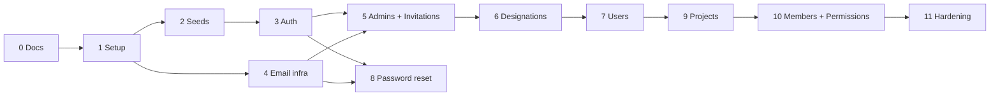

# SQL Workspace – Implementation Plan

> Phases are implemented **one at a time**. Each phase ends with owner review. Every phase's completion criteria include `npm run lint`, `npm run typecheck` and `npm test` passing, and `PROGRESS.md` being updated.

---

## Phase 0 – Documentation ✅
Create REQUIREMENTS, RULES, ARCHITECTURE, IMPLEMENTATION_PLAN and PROGRESS.
**Done when:** the owner approves all five documents.

## Phase 1 – Project Setup
**Depends on:** 0
**Tasks**
- `package.json`, TypeScript (strict), ESLint, Prettier, Jest and ts-jest, npm scripts (`dev`, `build`, `start`, `worker`, `lint`, `typecheck`, `test`, `db:migrate`, `db:seed`)
- `docker-compose.yml` with Postgres 16, Redis 7 and Mailpit. Add `.env.example` and `.gitignore`.
- `config/env.ts` (Zod validation), Sequelize connection, ioredis client, pino logger, `config/swagger.ts`
- `app.ts` and `server.ts` with helmet, CORS, body limit, cookie-parser, request id, and Swagger UI at `/api/docs`
- `src/models/` centralized model registry initialization
- `AppError` hierarchy, `errorHandler`, `notFound`, `validate` middleware, response helpers
- `GET /api/v1/health` (checks DB and Redis), `GET /api/docs` (Swagger UI), graceful shutdown

**Tests:** health endpoint, 404 shape, validation error shape, env validation failure, Swagger docs endpoint.
**Done when:** `docker compose up` followed by `npm run dev` serves `/health` with status 200 and `/api/docs` loads Swagger UI.

## Phase 2 – Roles, Permissions and Super Admin Seed
**Depends on:** 1
**Tasks**
- Migrations for `roles`, `permissions` and `users` (enable the citext extension)
- Idempotent seeders: the 3 roles, the 5 v1 permissions (`module = NULL`), and the Super Admin from env with `must_change_password`
- `GET /roles` and `GET /permissions` (read-only, require authentication once Phase 3 is done)

**Tests:** running the seeders twice doesn't create duplicates. Constraints reject a second Super Admin.
**Done when:** a fresh database plus `db:migrate` and `db:seed` produces a valid Super Admin.

## Phase 3 – Authentication Core
**Depends on:** 2
**Tasks**
- Login with bcrypt, lockout (5 failures → 15 minutes) and a neutral error response
- Access JWT, Redis refresh store, rotation and reuse detection, logout
- `authenticate` (with a status cache) and `authorize(...roles)` middleware
- `GET /auth/me`, `POST /auth/change-password` (ends other sessions, clears `must_change_password`)
- Force password change: users with `must_change_password` can only call `me`, `change-password` and `logout`
- Rate limiters for the auth routes

**Tests:** successful login, wrong password, lockout, refresh rotation, reuse detection, inactive user blocked, role guard.
**Done when:** the Super Admin can log in, must change the password, then gets full access.

## Phase 4 – Email Infrastructure
**Depends on:** 1
**Tasks**
- BullMQ `email` queue, worker entrypoint (`npm run worker`), Nodemailer transport
- Templates: `invitation` and `password-reset` (HTML and plain text)
- An `EmailService.enqueue()` helper with retry and backoff configuration

**Tests:** unit tests for rendering templates. The worker is tested with a mocked transport.
**Done when:** an enqueued test email appears in Mailpit.

## Phase 5 – Admin Management and Invitation Engine
**Depends on:** 3, 4
**Tasks**
- `invitations` migration and model. Token generation and hashing utilities.
- `InvitationService`: issue, verify, accept (sets password and activates), resend (revokes old, issues new), revoke, lazy expiry
- Super Admin endpoints: invite, list, view, update, activate, deactivate and delete Admins
- Creating an Admin seeds the 4 default designations *(needs the designations table, so its migration is pulled into this phase)*
- Deactivating an Admin cascades: sessions revoked for the Admin and all workspace users, and status cache invalidated

**Tests:** full invitation lifecycle, single-use link, expired link, resend invalidates the old link, revoke, duplicate email returns 409, deactivation cascade.
**Done when:** the J1, J3 and J6 journeys pass end-to-end with emails in Mailpit.

## Phase 6 – Designations
**Depends on:** 5
**Tasks:** CRUD with workspace scoping, unique names, blocking delete while in use, `PUT /designations/:id/permissions` for default templates, Super Admin `?adminId=` support.
**Tests:** tenant isolation (another Admin gets 404), unique name within a workspace, delete blocked while in use.
**Done when:** all of BR-13 to BR-18 are covered by tests.

## Phase 7 – Admin-Managed Users
**Depends on:** 6
**Tasks:** invite a user with a designation, list/view/update/change designation, activate/deactivate, soft delete (also removes project access later in Phase 10), resend or revoke the user's invitations.
**Tests:** J2 journey, tenant isolation, designation must belong to the same workspace, deactivated user can't log in.
**Done when:** BR-6 to BR-12, BR-15 and BR-33 to BR-42 are covered for users.

## Phase 8 – Forgot / Reset Password
**Depends on:** 3, 4
**Tasks:** `forgot-password` (neutral response, Redis token with a 1-hour TTL, a new request replaces the old one), `reset-password` (ends all sessions), rate limits.
**Tests:** J5 journey, unknown email gives the same response, token reuse fails, expiry.
**Done when:** BR-48 and BR-49 pass.

## Phase 9 – Projects
**Depends on:** 7
**Tasks:** CRUD, status (`ACTIVE`/`ARCHIVED`), date validation, unique names within a workspace, soft delete. Users see only projects they belong to (this filter is wired up in Phase 10).
**Tests:** BR-19 to BR-21, BR-30, tenant isolation.

## Phase 10 – Project Members and Permissions
**Depends on:** 9
**Tasks**
- `project_members` and `project_member_permissions` migrations
- Add a member, with the designation's defaults copied and optional overrides. Update grants. Remove a member.
- `requireProjectPermission(action)` middleware with a Redis grant cache and invalidation
- `MANAGE_MEMBERS` escalation rules (BR-29). `READ` is always included (BR-25).
- Users' project list filtered by membership. Archived projects are read-only (BR-21).
- Deactivating or deleting a user revokes their project access (BR-32)

**Tests:** J4 journey, all BR-29 escalation cases, cross-workspace member rejected, cache invalidation.
**Done when:** BR-22 to BR-32 are covered.

## Phase 11 – Integration and Hardening
**Depends on:** all
**Tasks:** end-to-end tests of journeys J1–J6, a security review (tenant scoping audit of every query, rate limits, headers), a comprehensive OpenAPI / Swagger audit (all schemas and endpoints verified), a README with setup instructions.
**Done when:** the owner signs off on v1.

